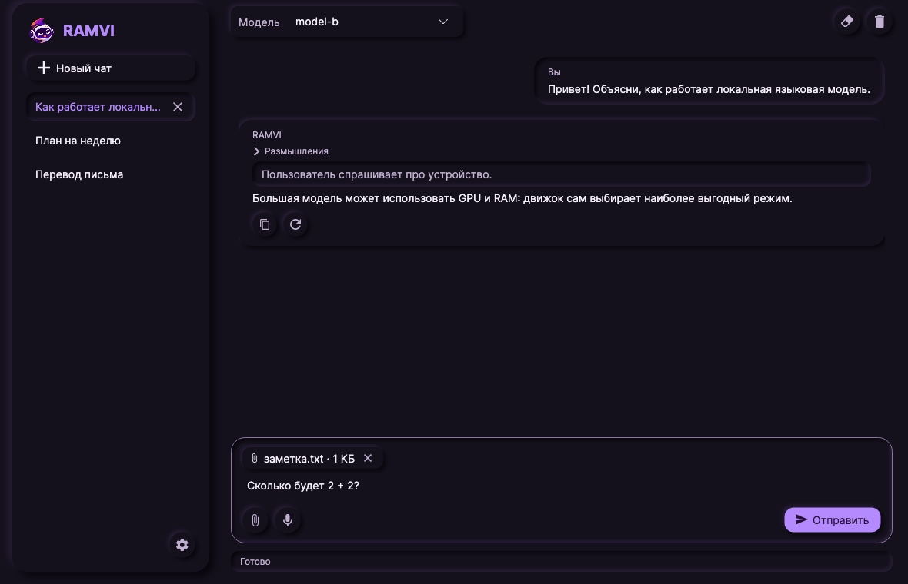
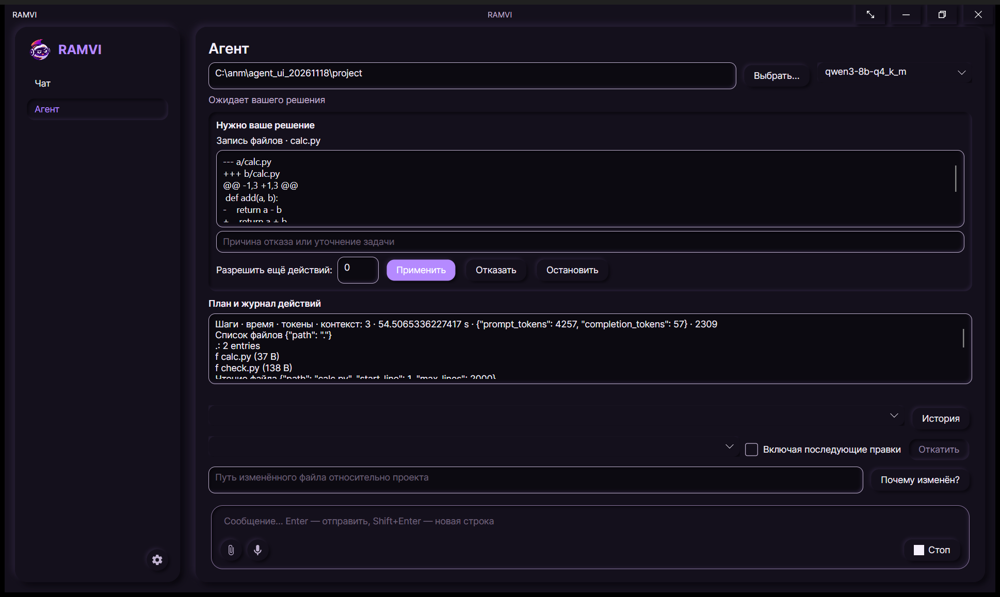
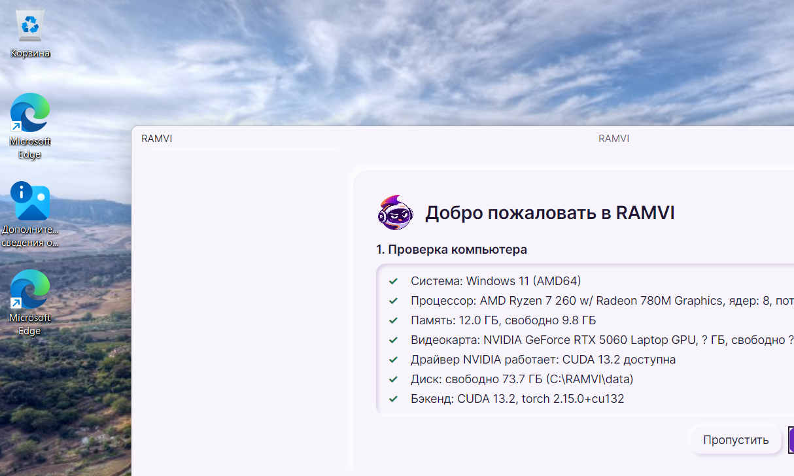

<div align="center">

# RAMVI

**Персональная AI-платформа для Windows и macOS.**

Работает на вашем компьютере, без подписки и без телеметрии. Облако подключается, только если вы сами этого хотите.

[**⬇ Скачать последнюю версию**](https://github.com/karabilo214/RAMVI/releases/latest) · [Лицензии](LICENSES.md) · [Сообщить об ошибке](https://github.com/karabilo214/RAMVI/issues) · [English](#english)

</div>

---

## Экраны

| Чат | Агент |
|---|---|
|  |  |

| Мастер запуска | Голосовой ввод |
|---|---|
|  |  |

<sub>Мастер запуска и агент сняты в настоящих окнах Windows. Мастер — в чистой Windows Sandbox без сети и без установленных библиотек, агент — на ноутбуке с RTX 5060 и моделью qwen3-8b. Чат и голосовой ввод отрисованы автотестами оболочки, текст в них тестовый.</sub>

## Функции

- **Чат.** Работает с моделями Qwen3 в формате GGUF, обычными и MoE. Размер не ограничен, лишь бы модель поместилась в видеопамять и оперативную память. Проверены модели от 0.6B до 32B и Qwen3-30B-A3B, они же есть во встроенном каталоге Hugging Face и Ollama. Можно подключить и свой файл, но одним куском: GGUF, разбитый на части, пока не открывается. В чате видно, как модель рассуждает. Если модель не помещается в видеопамять, часть слоёв работает из оперативной памяти. Llama, Gemma, Mistral и DeepSeek пока не поддерживаются, они в планах.
- **Голосовой ввод** на русском, английском и украинском. Речь распознаётся на вашем компьютере, микрофон включается только когда вы сами его включили.
- **Агент для файлов.** Читает, ищет и правит файлы только в папке, которую вы выбрали. Каждую правку сначала показывает как diff и применяет только после вашего подтверждения.
- **API для своих программ**, совместимый с OpenAI, Anthropic и Ollama. По умолчанию доступен только с этого компьютера. У каждого клиента свой ключ и свой счётчик токенов.
- **Без интернета.** Когда модель скачана, сеть больше не нужна.
- **Приватность.** Телеметрии нет. В сеть приложение выходит, только когда вы сами что-то делаете: открываете каталог моделей, скачиваете модель или проверяете обновления.
- **Без установки.** Запускается из любой папки, в том числе с флешки.
- **Горячие клавиши:** Ctrl+M — микрофон, Esc — остановить ответ или запись, Ctrl+N — новый чат.
- **Облачные модели по API.** Нужен ваш ключ OpenAI (в том числе для Codex), Anthropic (Claude), Google Gemini или совместимого сервиса: OpenRouter, DeepSeek, Groq, LM Studio. Облачную модель можно выбрать в чате, у агента, у персонажа и в своём API. Ключ лежит в защищённом хранилище системы. Рядом с выбранной моделью написано, куда уходят запросы. Расходы считаются, можно поставить лимит на день и на месяц. Пока вы не подключили облако, всё работает локально, как раньше. На Mac без NVIDIA Claude и Codex ответили в чате за 2,2–2,6 с, агент с инструментами решил задачу.
- **Персонаж** (отдельный модуль). Собеседник со своим характером: дружелюбный, саркастичный, строгий и другие. Говорит текстом и голосом, помнит о вас (память можно посмотреть и удалить) и подстраивается под ваши оценки. Многое зависит от модели. В опасной ситуации на облачных Claude и Codex персонаж отвечал всерьёз и называл номер экстренной службы в 4 ответах из 4, на локальной 8B — в 1 из 2.

## Системные требования для Windows

| | |
|---|---|
| Система | Windows 10 или 11, 64-бит |
| Видеокарта | **NVIDIA** (GeForce RTX и подобные) |
| Драйвер | **NVIDIA с поддержкой CUDA 13.2 или новее**: [скачать драйвер GeForce](https://www.nvidia.com/drivers) |
| Оперативная память | от 16 ГБ |
| Место на диске (SSD, HDD, NVMe) | от 3,3 ГБ |

Если драйвера нет или он устарел, RAMVI при запуске подскажет, что поставить.

Видеокарта NVIDIA и драйвер нужны только для локальных моделей. С облачными моделями RAMVI работает и без них.

## macOS (Apple Silicon)

С версии 0.9.0 есть сборка для Mac: `RAMVI-0.9.0-macos-arm64.zip`, 153 МиБ. В ней облачные модели, агент, персонаж и голосовой ввод. Локальных моделей на Mac нет, потому что движку нужна видеокарта NVIDIA. Мастер запуска сразу предложит подключить облачную модель. Нужен Mac на M1–M4 с macOS 12 или новее.

Программа пока не подписана Apple. Поэтому перед первым запуском снимите в Терминале метку «скачано из интернета»: `xattr -dr com.apple.quarantine /Applications/RAMVI.app` (укажите путь, где лежит программа). Можно и иначе: попробуйте запустить, затем откройте «Системные настройки» → «Конфиденциальность и безопасность» и нажмите «Открыть всё равно».

Проверяли на Mac M1 Pro. Архив распаковали в пустую папку, окно открылось, Claude ответил в чате за 1,9 с, агент с инструментами решил задачу, персонаж ответил в своём характере. torch и CUDA при этом не загружаются.

## Замеры

Ноутбук с RTX 5060 Laptop (8 ГБ видеопамяти), 16 ГБ оперативной памяти, Windows 11. RAMVI и Ollama 0.40.13 мерили в один день, 19.11.2026, на одном и том же наборе вопросов.

| Случай | RAMVI 0.8.0 | RAMVI 0.9.0 | Ollama 0.40.13 |
|---|---:|---:|---:|
| **Модель больше видеопамяти:** Qwen3-14B Q4_K_M (9,3 ГБ) с моделью-предсказателем Qwen3-0.6B, часть слоёв в видеопамяти, остальные в оперативной | **8,17** ток/с | **8,17** ток/с | 6,17 ток/с |
| **Модель целиком в видеопамяти:** Qwen3-8B Q4_K_M | 34,2 ток/с | 56,6 ток/с | **62,7** ток/с |
| Время до первого слова (медиана), 14B / 8B | 0,55 / 0,18 с | 0,55 / 0,18 с | **0,35 / 0,07** с |

- **14B.** RAMVI быстрее в 1,33 раза и обгоняет Ollama на 22 вопросах из 30.
- **8B.** В версии 0.9.0 RAMVI больше не включает предсказатель, если модель целиком помещается в видеопамять: в этом случае он только тормозил. Скорость выросла в 1,65 раза, ответы те же (совпали 30 из 30). Ollama на 8B пока быстрее примерно на 10%.
- **Первое слово** в обоих случаях быстрее выдаёт Ollama.

Как мерили: 30 вопросов разных типов (факты, код, математика, перевод, творческие задания и другие), до 200 токенов на ответ, температура 0, контекст 2048, размышления выключены. RAMVI и Ollama получали одинаковые запросы. RAMVI на 8B прогнали дважды: 56,61 и 56,65 ток/с, тексты совпали 30 из 30.

Выигрыш на 14B зависит от того, что за текст. На JSON RAMVI быстрее в 3,6 раза, на математике в 2,4, на коде в 2,0. А на творческих заданиях (0,80) и диалогах (0,89) медленнее Ollama: там предсказатель хуже угадывает следующие слова.

## Установка и первый запуск

1. Скачайте `RAMVI-<версия>-win-x64.zip` со страницы [Releases](https://github.com/karabilo214/RAMVI/releases/latest).
2. Распакуйте в любое место, на диск или на флешку. Устанавливать ничего не нужно, флешку можно переносить на другой компьютер.
3. Запустите **`RAMVI.exe`**.
4. Мастер проверит компьютер и предложит модель. **Моделей в архиве нет**: основную модель и маленькую модель-предсказатель, которая ускоряет ответы, приложение скачает само. Можно подключить и уже скачанный файл GGUF или модели Ollama.

Настройки и история лежат рядом с приложением, в папке `data`. Если в эту папку нельзя писать, RAMVI предложит выбрать другую.

## Обновления

Обновления подписаны ключом выпуска (Ed25519), поэтому неподписанный или изменённый пакет не установится. Если новая версия не запустится, RAMVI сам вернётся к прежней. Чаты, модели и настройки при обновлении остаются на месте.

## Исходный код

Код RAMVI открыт по лицензии MIT: [github.com/karabilo214/AI](https://github.com/karabilo214/AI), папка [ramvi](https://github.com/karabilo214/AI/tree/main/ramvi). Там сервис, движок, оболочка, тесты и отчёты проверок. В этом репозитории лежат готовые сборки, описание и лицензии.

## Состав и лицензии

Код RAMVI распространяется по лицензии [MIT](LICENSE). В архив входят сторонние компоненты, у каждого свои условия: Python, PyTorch с библиотеками NVIDIA CUDA и cuDNN, Triton, Transformers, whisper.cpp, .NET, Avalonia и другие. **Полный список со ссылками на все тексты лицензий — в [LICENSES.md](LICENSES.md)**, сами тексты — в папке [`licenses/`](licenses/) (такая же папка есть в архиве). Библиотеки NVIDIA и Microsoft можно использовать только в составе RAMVI, подробности в [THIRD_PARTY_TERMS.txt](licenses/THIRD_PARTY_TERMS.txt).

Целостность скачанного архива можно проверить по SHA-256, он указан в описании каждого релиза:

```powershell
Get-FileHash .\RAMVI-0.9.0-win-x64.zip -Algorithm SHA256
```

---

<a id="english"></a>

## English

**RAMVI is a personal AI platform for Windows and macOS.** It runs on your own computer, with no subscription and no telemetry. Cloud models are used only if you connect them yourself.

### Features

- **Chat** with Qwen3 models in GGUF format, dense and MoE. There is no size limit as long as the model fits into GPU memory plus RAM. Tested from 0.6B to 32B and Qwen3-30B-A3B; these are also in the built-in catalog. Your own file works too, but it has to be a single file: split GGUF files are not supported yet. Models that don't fit in GPU memory run partly from RAM. Llama, Gemma, Mistral and DeepSeek are not supported yet; they are planned.
- **Voice input** in Russian, English and Ukrainian, recognized on your computer. The microphone is on only when you turn it on.
- **File agent** that works only inside a folder you choose. Every change is shown as a diff first and applied only after you approve it.
- **API for your own tools**, compatible with OpenAI, Anthropic and Ollama. Local-only by default, with a separate key per client.
- Works offline once a model is downloaded. No installation needed: runs from any folder or a USB stick.
- **Shortcuts:** Ctrl+M — microphone, Esc — stop the reply or recording, Ctrl+N — new chat.
- **Cloud models via API** with your own OpenAI (including Codex), Anthropic (Claude), Google Gemini or compatible key. You can pick a cloud model in chat, for the agent, for the character and in the API. The key is kept in the system key store, the model picker shows where requests go, and costs are tracked with optional daily and monthly limits. Until you connect a cloud model, everything stays local. On a Mac without NVIDIA, Claude and Codex answered in chat in 2.2–2.6 s and the agent solved a task with tools. Cloud models don't need an NVIDIA GPU.
- **Character** (a separate module): a companion with a personality, text and voice, and a memory you can view and delete. A lot depends on the model. In an emergency, on cloud Claude and Codex it answered seriously and gave an emergency number in 4 of 4 replies; on local 8B, in 1 of 2.

### macOS (Apple Silicon)

`RAMVI-0.9.0-macos-arm64.zip`, 153 MiB, for M1–M4 Macs with macOS 12 or newer: cloud models, agent, character and voice input. There are no local models on Mac because the engine needs an NVIDIA GPU. The app isn't signed by Apple yet, so run `xattr -dr com.apple.quarantine /Applications/RAMVI.app` once, or try to open it and then go to System Settings → Privacy & Security → Open Anyway.

### System requirements for Windows

Windows 10 or 11, 64-bit; an **NVIDIA GPU** with a driver that supports **CUDA 13.2 or newer** ([GeForce drivers](https://www.nvidia.com/drivers)); 16 GB of RAM or more; 3.3 GB of free disk space (SSD, HDD or NVMe).

### Getting started

Download the ZIP from [Releases](https://github.com/karabilo214/RAMVI/releases/latest), unzip it anywhere (a disk or a USB stick) and run `RAMVI.exe`. Models are not included: the app downloads the main model and the small draft model itself.

### Benchmarks

RTX 5060 Laptop (8 GB), 16 GB RAM, the same 30 mixed prompts, up to 200 tokens, temperature 0, measured on the same day as Ollama 0.40.13. Qwen3-14B Q4_K_M (larger than VRAM) with a Qwen3-0.6B draft model: RAMVI 8.17 tok/s, Ollama 6.17 tok/s (RAMVI was faster on 22 of 30 prompts). Qwen3-8B fully in VRAM: RAMVI 0.8.0 34.2, 0.9.0 56.6, Ollama 62.7 tok/s. Ollama gives the first token faster in both cases.

### Source code

Open under MIT at [github.com/karabilo214/AI](https://github.com/karabilo214/AI), in the `ramvi` folder. This repository holds release builds, docs and licenses.

### Licenses

RAMVI is [MIT](LICENSE)-licensed; third-party components keep their own terms. [LICENSES.md](LICENSES.md) links to every license text.
