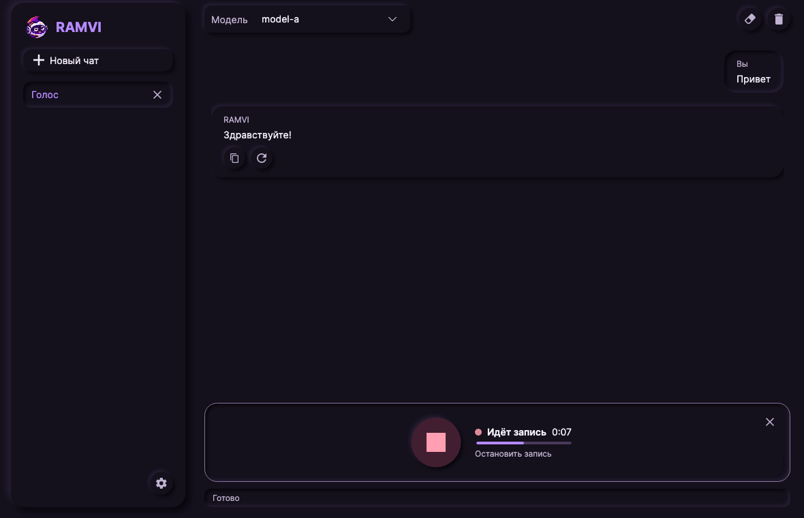

<div align="center">

# RAMVI

**RAMVI — ваша персональная AI-платформа для Windows.**

Без обязательного облака. Без подписки. Без телеметрии. Ваш ИИ — под вашим контролем.

[**⬇ Скачать последнюю версию**](https://github.com/karabilo214/RAMVI/releases/latest) · [Лицензии](LICENSES.md) · [Сообщить об ошибке](https://github.com/karabilo214/RAMVI/issues) · [English](#english)

</div>

---

## Как это выглядит

| Чат с моделью: видно, как она рассуждает | Агент ждёт вашего решения по правке (diff) |
|---|---|
|  |  |

| Первый запуск: мастер проверяет компьютер | Голосовой ввод: запись по кнопке или Ctrl+M |
|---|---|
|  |  |

<sub>Первый запуск и агент — снимки настоящих окон на Windows: первый запуск снят в чистой Windows Sandbox без сети и без установленных библиотек, агент — на ноутбуке с RTX 5060 (модель qwen3-8b). Чат и голос — тот же интерфейс, отрисованный автотестами оболочки с тестовым текстом.</sub>

## Что умеет

- 💬 **Чат с языковой моделью**: модели семейства **Qwen3** (GGUF, от 0.6B до 32B и Qwen3-30B-A3B) из встроенного каталога Hugging Face/Ollama или своим файлом. Видно, как модель рассуждает. Если модель больше видеопамяти, часть слоёв работает из оперативной памяти. Другие архитектуры (Llama, Gemma, Mistral, DeepSeek) пока не поддерживаются — они в планах.
- 🎙 **Голосовой ввод**: русский, английский, украинский. Распознавание работает на этом компьютере, микрофон включается только по кнопке или Ctrl+M.
- 🛠 **Агент для файлов**: читает, ищет и правит файлы только в той папке, которую вы выбрали. Каждое изменение показывается как diff, и применяется только после вашего подтверждения.
- 🔌 **API для своих программ**: совместим с OpenAI, Anthropic и Ollama, по умолчанию доступен только на этом компьютере. Ключи для каждого клиента отдельные, счётчики токенов тоже.
- 📴 **Работает без интернета** после того, как модель скачана.
- 🔒 **Приватность**: телеметрии нет. В сеть приложение ходит только по вашему действию: каталог моделей, загрузка модели, проверка обновлений.
- 🧳 **Переносимое**: установка не нужна, запускается из любой папки и с флешки.
- ☁️ **Облачные модели по API — в следующей версии**: по вашему ключу OpenAI (в том числе Codex), Anthropic (Claude), Google Gemini или совместимого сервиса; RAMVI работает транслятором для чата, агента и своего API. Ключ хранится в защищённом хранилище системы, у выбора модели видно, куда уходят запросы, есть лимиты расходов. Облако — только по вашему выбору, локальная работа не меняется. Проверено на Mac без NVIDIA: Claude и Codex ответили в чате за 2,2–2,6 с, агент с инструментами решил задачу.

## Требования

| | |
|---|---|
| Система | Windows 10 или 11, 64-бит |
| Видеокарта | **NVIDIA** (GeForce RTX и подобные) |
| Драйвер | **NVIDIA с поддержкой CUDA 13.2 или новее**: [скачать драйвер GeForce](https://www.nvidia.com/drivers) |
| RAM | ≥ 16 ГБ |
| SSD / HDD / NVMe | ≥ 3,3 ГБ |

Если драйвера нет или он старый, RAMVI при запуске скажет, что установить.

В следующей версии видеокарта NVIDIA и драйвер нужны только для локальных моделей: с облачными моделями по API RAMVI работает и без них.

## Скорость: замеры, а не обещание

Ноутбук с RTX 5060 Laptop (8 ГБ видеопамяти) и 16 ГБ RAM, Windows 11. RAMVI и Ollama 0.40.13 измерены в один день (19.11.2026) на одном наборе.

| Случай | RAMVI 0.8.0 | RAMVI, следующая версия | Ollama 0.40.13 |
|---|---:|---:|---:|
| **Модель больше видеопамяти:** Qwen3-14B Q4_K_M (9,3 ГБ) с моделью-предсказателем Qwen3-0.6B: часть слоёв в видеопамяти, остальное в RAM | **8,17** ток/с | **8,17** ток/с | 6,17 ток/с |
| **Модель целиком в видеопамяти:** Qwen3-8B Q4_K_M | 34,2 ток/с | 56,6 ток/с | **62,7** ток/с |
| Время до первого слова (медиана), 14B / 8B | 0,55 / 0,18 с | 0,55 / 0,18 с | **0,35 / 0,07** с |

- **14B:** RAMVI быстрее в 1,33 раза и обгоняет Ollama на 22 вопросах из 30.
- **8B:** в следующей версии RAMVI не включает предсказатель, если модель целиком помещается в видеопамять: там он только мешал. Скорость выросла в 1,65 раза при тех же ответах (совпали 30 из 30). Ollama на 8B пока быстрее примерно на 10%.
- **Первое слово** Ollama выдаёт быстрее в обоих случаях.

Как мерили: 30 вопросов разных типов (факты, код, математика, перевод, творчество и др.), до 200 токенов на ответ, температура 0, контекст 2048, размышления выключены; одинаковые запросы к RAMVI и к Ollama. RAMVI на 8B прогнан дважды — 56,61 и 56,65 ток/с, тексты совпали 30 из 30.

Честно об ограничениях: выигрыш на 14B зависит от типа текста. На JSON он 3,6×, на математике 2,4×, на коде 2,0×, а на творчестве (0,80×) и диалогах (0,89×) RAMVI медленнее Ollama: там предсказатель хуже угадывает.

## Установка и первый запуск

1. Скачайте `RAMVI-<версия>-win-x64.zip` со страницы [Releases](https://github.com/karabilo214/RAMVI/releases/latest).
2. Распакуйте в любое место: на диск или на флешку. RAMVI запускается прямо оттуда, установка не нужна, флешку можно подключать к другому компьютеру.
3. Запустите **`RAMVI.exe`**.
4. Мастер проверит компьютер и предложит модель. **Модели в архив не входят**: основную модель и маленькую модель-предсказатель (ускоряет ответы) приложение скачивает само из каталога. Можно и подключить уже скачанный файл GGUF или модели Ollama.

Настройки и история хранятся рядом с приложением, в папке `data`. Если папка открыта только на чтение, RAMVI предложит выбрать другую.

## Обновления

Обновления подписаны ключом выпуска (Ed25519). Неподписанный или изменённый пакет не установится. Если новая версия не запустится, RAMVI сам вернётся к прежней. Чаты, модели и настройки обновление не трогает.

## Исходный код

Исходный код RAMVI открыт по лицензии MIT: [github.com/karabilo214/AI](https://github.com/karabilo214/AI), папка [ramvi](https://github.com/karabilo214/AI/tree/main/ramvi) — сервис, движок, оболочка, тесты и отчёты проверок. В этом репозитории — готовые сборки, описание и лицензии.

## Состав и лицензии

Код RAMVI распространяется по лицензии [MIT](LICENSE). В архив входят сторонние компоненты: Python, PyTorch с библиотеками NVIDIA CUDA и cuDNN, Triton, Transformers, whisper.cpp, .NET и Avalonia и другие. У каждого свои условия. **Полный список со ссылками на все тексты — [LICENSES.md](LICENSES.md)**, сами тексты — в папке [`licenses/`](licenses/) (та же папка есть внутри архива). Библиотеки NVIDIA и Microsoft можно использовать только в составе RAMVI, подробнее — [THIRD_PARTY_TERMS.txt](licenses/THIRD_PARTY_TERMS.txt).

Проверить целостность скачанного архива можно по SHA-256, он указан в описании каждого релиза:

```powershell
Get-FileHash .\RAMVI-0.8.0-win-x64.zip -Algorithm SHA256
```

---

<a id="english"></a>

## English

**RAMVI is your personal AI platform for Windows.** No mandatory cloud. No subscription. No telemetry. Your AI, under your control.

- Chat with **Qwen3** family models (GGUF, 0.6B–32B and Qwen3-30B-A3B), including models larger than your GPU memory (hybrid GPU+RAM). Other architectures (Llama, Gemma, Mistral, DeepSeek) are not supported yet — planned.
- Local voice input (Russian, English, Ukrainian); the microphone turns on only when you press the button or Ctrl+M.
- File agent restricted to a folder you choose. Every change is shown as a diff and needs your approval.
- OpenAI-, Anthropic- and Ollama-compatible API for your own tools, local-only by default, with a separate key per client.
- Works offline once a model is downloaded. Portable: no installation, runs from any folder or a USB stick.
- **Next version — cloud models via API:** with your own OpenAI (incl. Codex), Anthropic (Claude), Google Gemini or compatible key, RAMVI acts as a translator for chat, agent and its API. The key stays in the system key store, the model picker shows where requests go, spending limits are available. Cloud is opt-in; local work is unchanged. Tested on a Mac without NVIDIA: Claude and Codex answered chat in 2.2–2.6 s, the agent solved a task with tools. With cloud models only, no NVIDIA GPU is needed.

**Requirements:** Windows 10/11 x64, an **NVIDIA GPU** with a driver that supports **CUDA 13.2 or newer** ([GeForce drivers](https://www.nvidia.com/drivers)), RAM ≥ 16 GB, SSD/HDD/NVMe ≥ 3.3 GB.

**Getting started:** download the ZIP from [Releases](https://github.com/karabilo214/RAMVI/releases/latest), unzip it anywhere (a disk or a USB stick) and run `RAMVI.exe`. No models are included: the app downloads the model and the small draft model itself.

**Speed (measured, not promised; RTX 5060 Laptop 8 GB, 16 GB RAM, same 30 mixed prompts, ≤200 tokens, temperature 0, measured the same day vs Ollama 0.40.13):** Qwen3-14B Q4_K_M (larger than VRAM) with a Qwen3-0.6B draft model — RAMVI 8.17 tok/s vs Ollama 6.17 (faster on 22/30 prompts). Qwen3-8B fully in VRAM — RAMVI 0.8.0 34.2, next version 56.6, Ollama 62.7 tok/s. Ollama has a faster first token in both cases.

**Source code:** open under MIT at [github.com/karabilo214/AI](https://github.com/karabilo214/AI) (folder `ramvi`); this repository holds release builds, docs and licenses.

**Licenses:** RAMVI is [MIT](LICENSE)-licensed; third-party components keep their own terms. See [LICENSES.md](LICENSES.md) for links to every license text.
